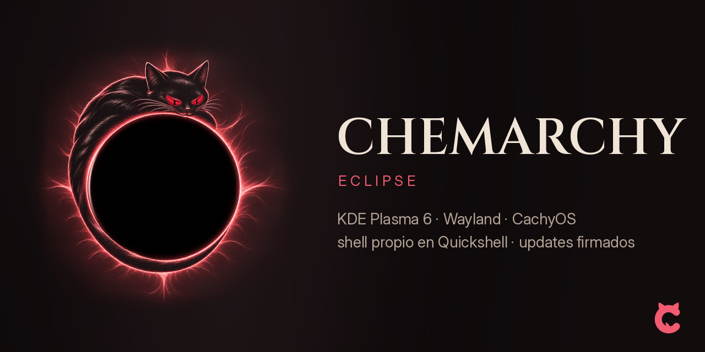

# chemarchy

[Español](README.md) · **English**


<p align="center">
  
</p>

An opinionated, curated take on KDE Plasma 6 (Wayland) on top of CachyOS/Arch: its own Quickshell shell, themes that
carry across your apps (seven of them; the default is **Eclipse**, chemarchy's signature look: reddish black with a
crimson corona), tiling, a dock, keyboard shortcuts and a first-boot assistant. **Installing takes one command.**

**What's new:**
- **A brand of its own:** the logo is a "C" drawn as a curled-up cat, and **Kuro**, the mascot, lives on top of your
  windows, reacts to your typing, dozes off and picks up your theme's colors.
- **Seven themes, each with its own wallpaper:** every theme gets its own scene of Kuro and the eclipse, in its own
  colors. In the terminal, fastfetch shows an animated emblem of Kuro asleep on the eclipse.
- **Updates that look after themselves:** if CachyOS ships a kernel before the matching NVIDIA driver, chemarchy holds
  the kernel back and updates everything else. With Btrfs and Snapper (the way chemarchy's installer sets things up),
  every package change takes a snapshot first, and you can boot back into it from the Limine boot menu.
- **`chemarchy fleet`:** the status of all your machines (kernel, pending reboot, backups) in a single table.

<p align="center">
  
</p>

## Install — you already have CachyOS/Arch + KDE Plasma (1 command)

```bash
curl -fsSL https://github.com/chemaw8/chemarchy-repo/raw/main/install.sh | bash
```

That syncs the clock, installs the signing key (checking its fingerprint), adds the signed `[chemarchy]` repo,
installs the meta-package and deploys the config to your `$HOME`. On your **next login**, an assistant runs to finish
setting things up.

Rather look before you run it? (recommended for any `curl|bash`):

```bash
curl -fsSL https://github.com/chemaw8/chemarchy-repo/raw/main/install.sh -o install.sh
less install.sh        # read it
bash install.sh        # run it
```

With options: `… | bash -s -- --channel rc --no-extras`
· or the edge channel: `curl -fsSL … | bash -s -- --channel edge`.

## New or empty computer (ISO)

There is **no published ISO** with its checksum yet, so for now the only route is the one above: install CachyOS with
KDE Plasma (using its official installer), then run the install command. Once an ISO is published, this is where
you'll find the download link, its `.sha256` and the steps to write it to a USB stick.

If you've already booted a chemarchy ISO (live session), the installer is the **Instalar chemarchy** (Install
chemarchy) icon on the desktop; the guide `~/Documentos/CHEMARCHY-empieza-aqui.md` (in Spanish) explains what to
expect next.

## After installing

- `chtheme pick` — switch themes · `chemarchy apps` — app bundles · `chemarchy update` — update
- `chemarchy-channel-set stable|rc|edge` — switch channels · `chemarchy doctor` — diagnose/repair
- `Super+/` — full cheatsheet · `chemarchy help` — every command
- Re-run the assistant: `chemarchy-wizard --force`

If anything gets stuck along the way, the message tells you the exact command to run (`chemarchy doctor`,
or retrying `curl … | bash`). The goal: an install that needs **no human help**.

## Passwordless sudo (installs from an ISO)

When you install from a chemarchy ISO, the `wheel` group (your user) gets `sudo` **without a password**, just like in
the live session (`/etc/sudoers.d/g_wheel`). It's a deliberate project decision: convenient, but any program running
as your user can become root. The install command (`install.sh`) leaves your sudo setup alone.

To undo it and have `sudo` ask for a password again:

```bash
sudo passwd "$USER"                       # 1. if you don't have a password yet (or can't remember it): set one
sudo visudo -f /etc/sudoers.d/g_wheel     # 2. make the line read:  %wheel ALL=(ALL:ALL) ALL
sudo visudo -c                            # 3. validate the whole sudo configuration
sudo -k; sudo true                        # 4. it should now ask for the password from step 1
```

Don't delete `g_wheel`: it's usually the only rule for `wheel`, and without it you're left with no sudo at all. If
step 3 reports an error, redo step 2 before closing the terminal.

## AI

The AI sidebar (`Meta+Shift+I`) and `chemarchy ai` use Claude through **your own Claude Code account** (you need
`claude` signed in; there's no API key to configure). **It isn't local:** whatever you send it, including
screenshots and OCR text, goes to Anthropic. `chemarchy diagnose` redacts sensitive data before sending anything
(`chemarchy-diagnose --evidence` shows what would go out).

## Brand

The logo, the terminal emblem, Kuro and the wallpapers featuring them are © chema, all rights reserved: they may be
redistributed unmodified as part of chemarchy, but may not be used to identify any other project. The rest of
chemarchy is MIT-licensed.

## The repo signing key

This is chemarchy's **signed pacman channel** — the `[chemarchy]` repo. It hosts only the **signed packages and
database** (Release assets); the source code is private. Everything is signed with the repo's dedicated key:

```
KEYID  069CA59152A9E92A
FPR    9019 9772 56F9 F5CD D490  7C02 069C A591 52A9 E92A
UID    Chemarchy Repository Signing Key <chemarchy@chemaw8.github.io>
```

---

> Distribution repo; the `stable`/`rc`/`edge` channels are Release tags. Every package and the db are
> verified with `SigLevel=Required` against the key above. Customize it without forking:
> `cp /usr/share/chemarchy/user.conf.example ~/.config/chemarchy/user.conf`.
