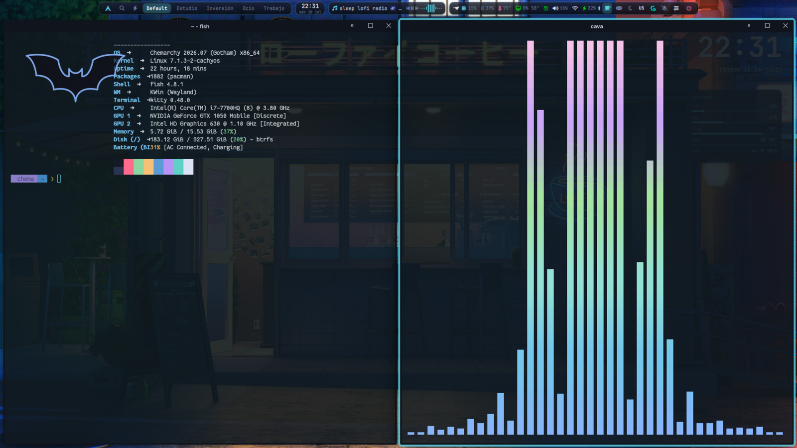

# chemarchy-repo

Canal **pacman firmado** de [chemarchy](https://github.com/chemaw8/chemarchy) — el repo `[chemarchy]`.
Aquí viven solo los **paquetes y la base de datos firmados** (assets de Release); el fuente es privado.

Firmados con la llave dedicada del repo:

```
KEYID  069CA59152A9E92A
FPR    9019 9772 56F9 F5CD D490  7C02 069C A591 52A9 E92A
UID    Chemarchy Repository Signing Key <chemarchy@chemaw8.github.io>
```




Una curaduría opinada de KDE Plasma + Catppuccin sobre CachyOS/Arch: barra Quickshell, temas que se
siguen entre apps (la misma escena de arriba existe en
[cuatro temas](https://github.com/chemaw8/chemarchy-repo/raw/main/assets/chemarchy-gotham.png)),
tiling, dock, atajos y un wizard de primer arranque. **Instalar es de 0–1 comandos.**

## Camino 1 — Ya tienes CachyOS/Arch + KDE (1 comando)

```bash
curl -fsSL https://github.com/chemaw8/chemarchy-repo/raw/main/install.sh | bash
```

Eso sincroniza el reloj, instala la llave (verificando su fingerprint), añade el repo firmado
`[chemarchy]`, instala el meta-paquete y despliega la config a tu `$HOME`. Al **siguiente login**
corre un asistente que termina de personalizar.

¿Prefieres inspeccionar antes de correr? (recomendado para cualquier `curl|bash`):

```bash
curl -fsSL https://github.com/chemaw8/chemarchy-repo/raw/main/install.sh -o install.sh
less install.sh        # léelo
bash install.sh        # córrelo
```

Con opciones: `… | bash -s -- --channel rc --no-extras`
· o por variable: `CHEMARCHY_CHANNEL=edge curl -fsSL … | bash`.

## Camino 2 — Computadora nueva / vacía (bare-metal, 0 comandos en terminal)

1. **Descarga el ISO** (último release de chemarchy).
2. **Flashéalo a una USB** (≥8 GB; borra la USB):
   - **Linux:** Impression o Ventoy (copias el .iso a la USB), o `dd`:
     `sudo dd if=chemarchy-*.iso of=/dev/sdX bs=4M status=progress oflag=sync` (sustituye `/dev/sdX` por tu USB; verifica con `lsblk`).
   - **Windows:** Rufus (modo DD) o balenaEtcher.
   - **macOS:** balenaEtcher.
3. **Arranca desde la USB.** Al encender, abre el **menú de arranque** con la tecla de tu placa
   (suele ser **F12**, a veces **F11/F8/F9/ESC**; en algunas hay que entrar a la **BIOS/UEFI** con **Del/F2**
   y poner la USB primero) → elige la entrada **CHEMARCHY**.
4. **Instala con Calamares** (se abre solo en la sesión live): idioma → zona → teclado → particiones →
   **crea tu usuario** (el único texto que escribes) → **Instalar**. Es **offline**: copia el sistema tal
   cual, sin descargar nada.
5. **Reinicia y quita la USB.** En el **primer login**, un asistente (tema/WiFi/GPU/apps) te recibe.

## Después de instalar (cualquiera)

- `chtheme pick` — cambia de tema · `chemarchy apps` — bundles de apps · `chemarchy update` — actualiza
- `chemarchy-channel-set stable|rc|edge` — cambia de canal · `chemarchy doctor` — diagnostica/repara
- `Super+/` — cheatsheet completo · `chemarchy help` — todos los comandos
- Re-correr el asistente: `chemarchy-wizard --force`

Si algo se atora en cualquier punto, el mensaje te dice el comando exacto a correr (`chemarchy doctor`,
o reintentar `curl … | bash`). El objetivo: instalarlo **sin ayuda humana**.

## sudo sin contraseña (instalaciones desde el ISO)

Al instalar desde el ISO, el grupo `wheel` (tu usuario) queda con `sudo` **sin contraseña**, igual que
en la sesión live (`/etc/sudoers.d/g_wheel`). Es una decisión del proyecto: cómodo, pero cualquier
programa que corra con tu usuario puede ser root. El camino 1 no toca tu sudo.

Para quitarlo y que `sudo` vuelva a pedir contraseña:

```bash
sudo passwd "$USER"                       # 1. si aún no tienes contraseña (o no la recuerdas): fíjala
sudo visudo -f /etc/sudoers.d/g_wheel     # 2. deja la línea así:  %wheel ALL=(ALL:ALL) ALL
sudo visudo -c                            # 3. valida toda la configuración de sudo
sudo -k; sudo true                        # 4. debe pedirte la contraseña del paso 1
```

No borres `g_wheel`: suele ser la única regla de `wheel` y sin ella te quedas sin sudo. Si el paso 3
marca un error, repite el paso 2 antes de cerrar la terminal.

## IA

El sidebar de IA (`Meta+Shift+I`) y `chemarchy ai` usan Claude con **tu cuenta de Claude Code** (hace falta
`claude` con sesión iniciada; no se configura API key). **No es local:** lo que le mandas, incluidas
capturas y texto de OCR, viaja a Anthropic. `chemarchy diagnose` oculta datos sensibles antes de enviar
(`chemarchy-diagnose --evidence` muestra qué saldría).

---

> Repo de distribución; canales `stable`/`rc`/`edge` = tags de Release. Cada paquete y la db se
> verifican con `SigLevel=Required` contra la llave de arriba. Personalización sin forkear:
> `cp /usr/share/chemarchy/user.conf.example ~/.config/chemarchy/user.conf`.
